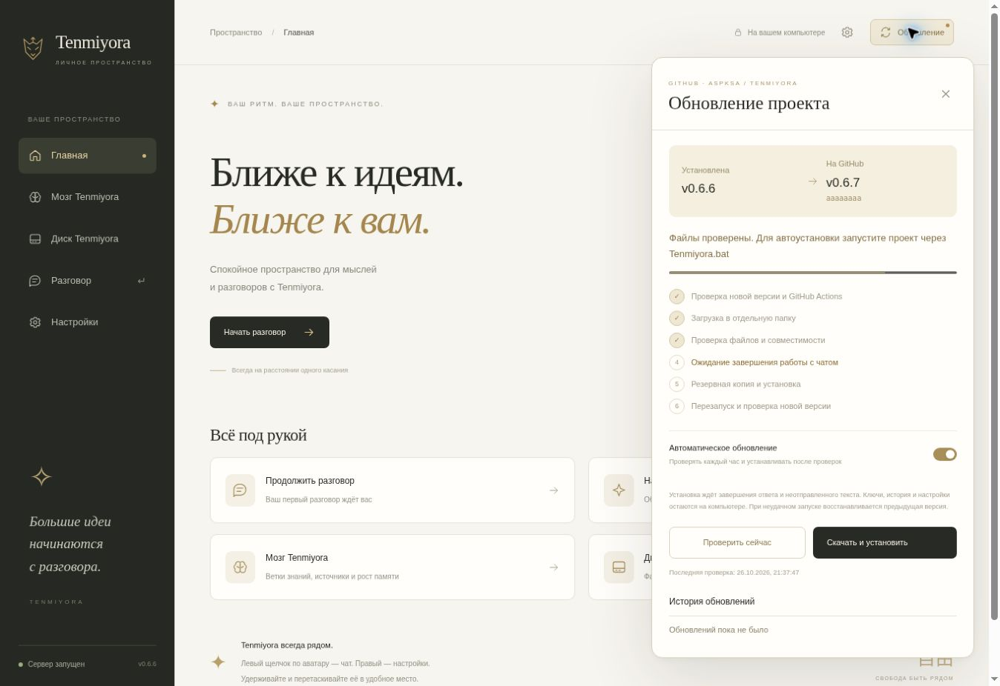

# Проверка обновления 0.6.6

Проверены Windows и Ubuntu в GitHub Actions. На Windows прошли все 89 Python-тестов, включая `test_restart_and_failed_version_rollback`: настоящий BAT, смена PID и версии, сохранение адреса и данных, затем откат версии с намеренной ошибкой запуска. GitHub API и архив в этом интеграционном тесте заменены локальным HTTP-сервером; реальная установка на компьютер пользователя не выполнялась.

Сохранены проверки качества Мозга: основной контрольный набор и 80 сложных документов. Проверены JavaScript и размещение окон.

В браузере проверены открытие панели справа сверху, получение доступной версии, загрузка и проверка файлов, переключатель автоматики, переход в Мозг и окно при ширине 390 пикселей. Снимок ниже сделан на тестовом источнике: доступная 0.6.7 и коммит `aaaaaaaa` — данные проверки, а не опубликованный выпуск. В браузерной Linux-проверке установка только подготавливается; перезапуск проверен отдельно на Windows.

